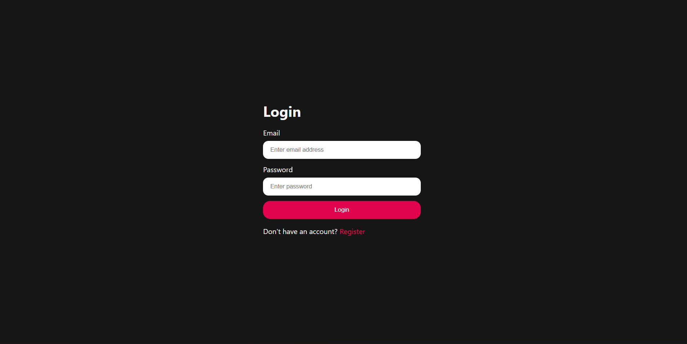
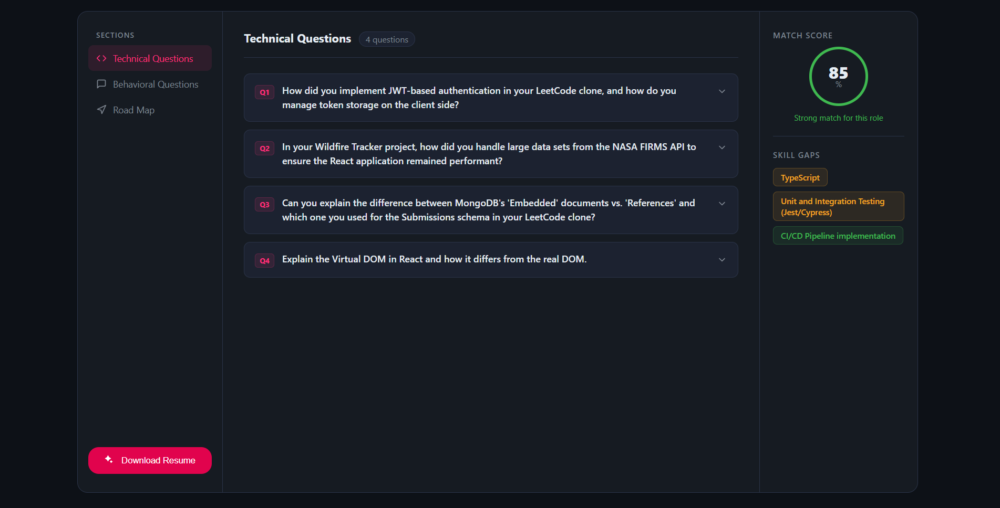
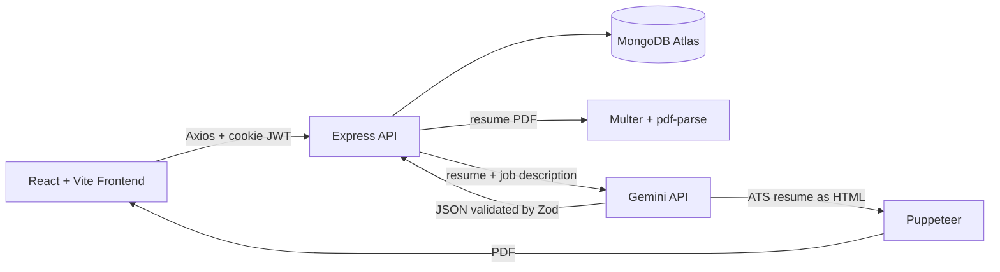

<div align="center">

# 🧭 PrepPilot

**Turn any job description into a personalized interview game plan.**

Upload your resume, paste a job description, and get a match score, skill gaps, likely interview questions, a day-by-day prep roadmap, and an ATS-optimized resume PDF, all in one place.

[**🚀 Live Demo**](https://prep-pilot-smoky.vercel.app/) · [Report a Bug](https://github.com/nikhilrautan/PrepPilot/issues) · [Request a Feature](https://github.com/nikhilrautan/PrepPilot/issues)


</div>

---

## 📖 Table of Contents

- [Why PrepPilot?](#-why-preppilot)
- [Features](#-features)
- [Screenshots](#-screenshots)
- [Tech Stack](#-tech-stack)
- [Architecture](#-architecture)
- [Project Structure](#-project-structure)
- [Getting Started](#-getting-started)
- [Environment Variables](#-environment-variables)
- [API Overview](#-api-overview)
- [Troubleshooting](#-troubleshooting)
- [Roadmap](#-roadmap)
- [Contributing](#-contributing)
- [Acknowledgements](#-acknowledgements)
- [Author](#-author)

---

## 💡 Why PrepPilot?

Generic interview advice doesn't help when you're applying for a *specific* role. PrepPilot compares **your** resume against **that** job description and tells you exactly where you stand, what's missing, what you'll likely be asked, and how to spend the days before your interview.

## ✨ Features

| | Feature | Description |
| --- | --- | --- |
| 🔐 | **Secure authentication** | Register and log in with a JWT stored in an HTTP cookie. Logout blacklists the token so it can't be reused. |
| 📄 | **Resume analysis** | Upload a PDF resume (or write a short self-description) and the app extracts your skills and experience. |
| 🎯 | **Match score** | See how well your profile fits a specific job description. |
| 🧩 | **Skill gap detection** | Find which required skills are missing from your resume, ranked by severity. |
| ❓ | **Interview questions** | Technical and behavioral questions tailored to the role, with guidance on how to answer. |
| 🗓️ | **Preparation roadmap** | A day-by-day plan to close your gaps before the interview. |
| 📑 | **ATS-optimized resume** | The AI rewrites your resume for the job description, and Puppeteer exports it as a downloadable PDF. |
| 🕘 | **Report history** | Every report is saved so you can revisit past analyses. |

## 🖼️ Screenshots

> Replace the placeholders below with real images (e.g. in a `/docs/screenshots` folder).

| Home | Interview Report | Generated Resume |
| --- | --- | --- |
|  |  |  |

## 🛠️ Tech Stack

| Layer | Technology |
| --- | --- |
| Frontend | React, Vite, React Router, Axios, SCSS |
| Backend | Node.js, Express |
| Database | MongoDB Atlas (Mongoose) |
| Authentication | JWT, HTTP-only cookies, token blacklisting |
| AI | Google Gemini API (`@google/genai`), Zod for response validation |
| File handling | Multer (upload), pdf-parse (resume parsing) |
| PDF generation | Puppeteer |

## 🏗️ Architecture



### How it works

1. A user registers and logs in. The server sets a JWT in a cookie.
2. The user uploads a resume and pastes a job description.
3. The backend parses the PDF and sends the resume, self-description, and job description to Gemini.
4. The AI response is validated against a Zod schema and saved in MongoDB as an interview report.
5. The frontend displays the match score, skill gaps, questions, and roadmap.
6. On request, the backend asks Gemini for an ATS-optimized resume as HTML and renders it to PDF with Puppeteer.

## 📁 Project Structure

```
PrepPilot/
├── Backend/
│   ├── server.js
│   └── src/
│       ├── config/         # database connection
│       ├── controllers/    # auth and interview logic
│       ├── middlewares/    # auth, file upload
│       ├── models/         # user, interview report, token blacklist
│       ├── routes/
│       └── services/       # Gemini AI and PDF generation
└── Frontend/
    └── src/
        └── features/       # auth and interview (api, hooks, context, pages, styles)
```

## 🚀 Getting Started

### Prerequisites

- [Node.js](https://nodejs.org/) (LTS version)
- A [MongoDB Atlas](https://www.mongodb.com/atlas) account (the free tier works)
- A [Google AI Studio](https://aistudio.google.com/) API key (the free tier works)

### 1. Clone the repository

```bash
git clone https://github.com/nikhilrautan/PrepPilot.git
cd PrepPilot
```

### 2. Set up the backend

```bash
cd Backend
npm install
```

Create a `.env` file in the `Backend` folder (see [Environment Variables](#-environment-variables)), then start the server:

```bash
npm run dev
```

The API runs on `http://localhost:3000`.

### 3. Set up the frontend

Open a second terminal:

```bash
cd Frontend
npm install
npm run dev
```

The app runs on `http://localhost:5173`.

## 🔑 Environment Variables

Create `Backend/.env`:

```env
MONGO_URI=your_mongodb_connection_string
JWT_SECRET=your_long_random_secret
GOOGLE_GENAI_API_KEY=your_gemini_api_key
```

| Variable | Description |
| --- | --- |
| `MONGO_URI` | MongoDB Atlas connection string |
| `JWT_SECRET` | Long random string used to sign JWTs |
| `GOOGLE_GENAI_API_KEY` | API key from Google AI Studio |

> ⚠️ Never commit your `.env` file. Make sure it is listed in `.gitignore`.

## 🔌 API Overview

<!-- Adjust these routes to match your actual Express routers. -->

| Method | Endpoint | Description | Auth |
| --- | --- | --- | --- |
| `POST` | `/api/auth/register` | Create an account | No |
| `POST` | `/api/auth/login` | Log in and set the JWT cookie | No |
| `GET` | `/api/auth/logout` | Log out and blacklist the token | Yes |
| `GET` | `/api/auth/get-me` | Get the current user | Yes |
| `POST` | `/api/interview` | Upload resume + job description, generate a report | Yes |
| `GET` | `/api/interview` | List all of your past reports | Yes |
| `GET` | `/api/interview/:id` | Get a single report | Yes |
| `POST` | `/api/interview/resume/pdf/:id` | Generate the ATS-optimized resume PDF | Yes |

## 🩺 Troubleshooting

| Problem | Fix |
| --- | --- |
| `429 Too Many Requests` from Gemini | You hit the free-tier rate limit. Wait a minute and retry. |
| Cookie not set / user logged out immediately | Make sure the frontend and backend origins match your CORS and cookie settings (`withCredentials` on Axios). |
| MongoDB connection fails | Check `MONGO_URI` and that your IP is allowed under **Network Access** in Atlas. |
| Resume upload fails | Only PDF files are supported for now. |
| Puppeteer fails on a hosting platform | Some hosts need extra system dependencies or a Chromium-compatible setup to render PDFs. |

> 🔒 **Privacy note:** requests sent through the Gemini free tier may be used by Google to improve its products. Use a sample resume when testing.

## 🗺️ Roadmap

- [x] Frontend deployment on Vercel
- [ ] Backend deployment (Render)
- [ ] Support DOCX resume uploads
- [ ] Mock interview mode with answer feedback
- [ ] Cover letter generator
- [ ] Progress dashboard across multiple reports

## 🤝 Contributing

Contributions, issues, and feature requests are welcome.

1. Fork the repo
2. Create your branch: `git checkout -b feature/your-feature`
3. Commit your changes: `git commit -m "Add your feature"`
4. Push to the branch: `git push origin feature/your-feature`
5. Open a Pull Request

## 🙏 Acknowledgements

This project was built while following the full-stack Gen AI tutorial by **Ankur Prajapati** ([Sheryians Coding School](https://sheryians.com/)). Original source code: [ankurdotio/interview-ai-yt](https://github.com/ankurdotio/interview-ai-yt).

## 👤 Author

**Nikhil Rautan**: [GitHub](https://github.com/nikhilrautan)

---

<div align="center">

If PrepPilot helped you, consider giving it a ⭐

</div>
